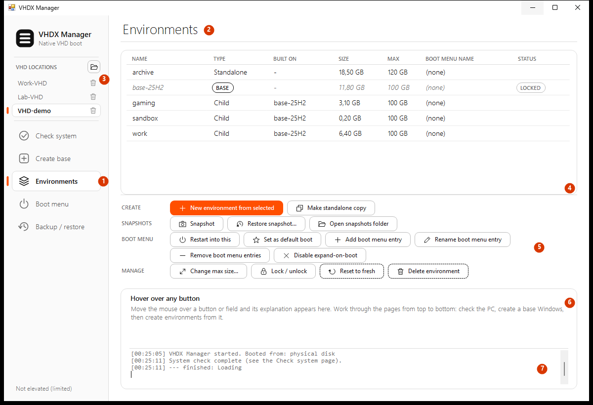
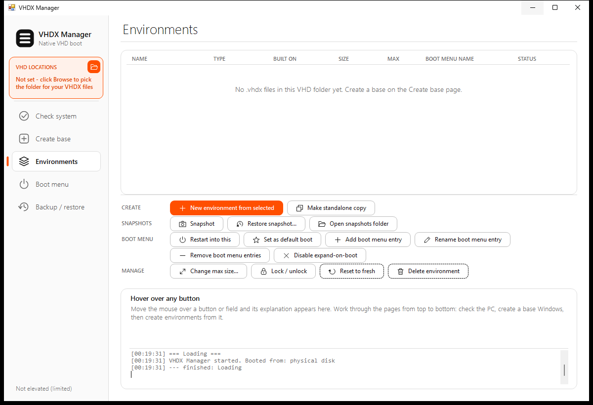
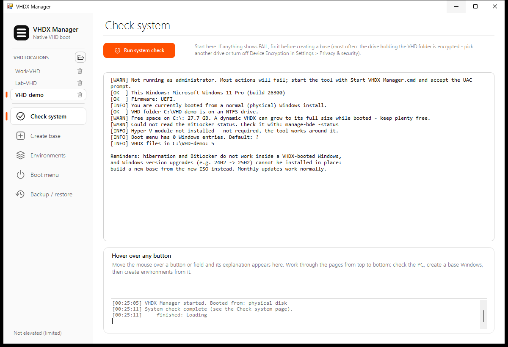
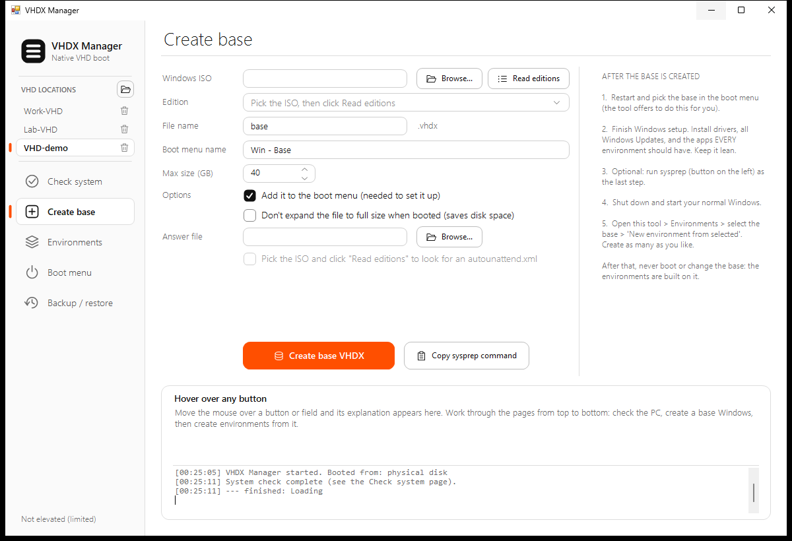
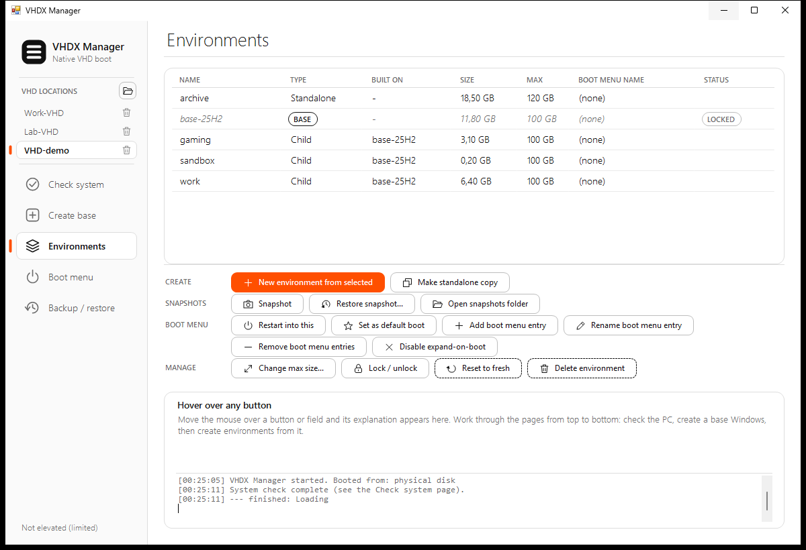
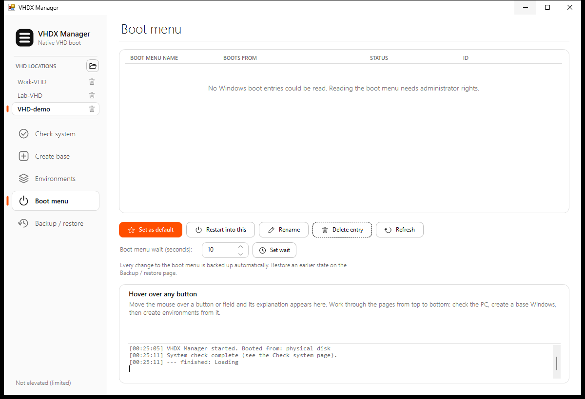
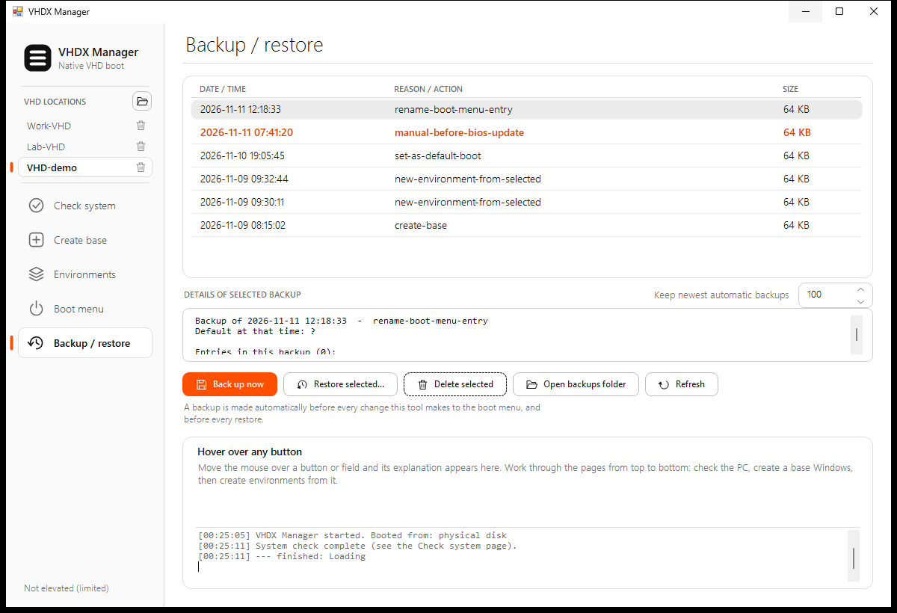
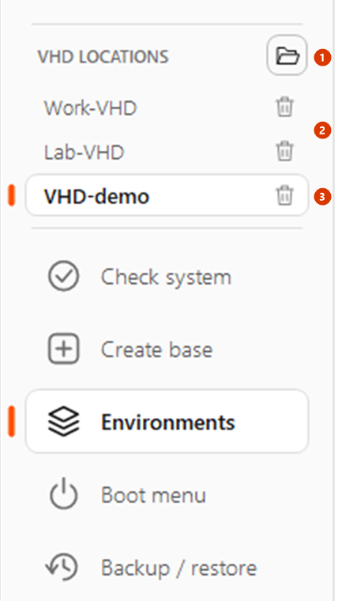

# VHDX Manager - User Guide

VHDX Manager is a point-and-click Windows tool for running **several independent, bare-metal Windows installs** from `.vhdx` files, using Windows' built-in _native VHD boot_.

You build one clean **base** Windows once. Then you create as many lightweight **environments** (work, gaming, sandbox, ...) on top of it. Each environment stores only its own changes, so it starts at a few MB, boots on real hardware (no virtual machine), and can be snapshotted, rolled back, reset to fresh or resized.

It is a single PowerShell script with a WinForms window. No installation, no dependencies. Every button has a hover description inside the app.

**What you get**

- A **system check** that tells you whether your PC can do this.
- **Create base**: Windows ISO to a ready-to-boot base disk, optionally with an answer file.
- **Environments**: create, snapshot, restore, reset, resize, copy, lock and delete.
- **Boot menu** management: default, rename, delete entries, one-time restart, wait time.
- **Automatic boot-configuration backups** before every change, and one-click restore of any earlier state.

> The screenshots in this guide were taken on a PC without administrator rights, with demo files in a demo folder (`C:\VHD-demo`). Disk sizes and the empty boot-menu list are therefore demo data; on your PC you will see your own files and boot entries. Number formats follow your Windows language (for example `18,50 GB` or `18.50 GB`).

---

## Contents

- [How it works](#how-it-works)
- [Requirements](#requirements)
- [Install and launch](#install-and-launch)
- [Quick tour of the window](#quick-tour-of-the-window)
- [Guide 1: First-time setup - build a base](#guide-1-first-time-setup---build-a-base)
- [Guide 2: Create your first environment](#guide-2-create-your-first-environment)
- [Guide 3: Daily use - boot, snapshot, restore, reset](#guide-3-daily-use---boot-snapshot-restore-reset)
- [Guide 4: Resize an environment](#guide-4-resize-an-environment)
- [Guide 5: Make a standalone copy](#guide-5-make-a-standalone-copy)
- [Guide 6: Manage the boot menu](#guide-6-manage-the-boot-menu)
- [Guide 7: Back up and restore the boot configuration](#guide-7-back-up-and-restore-the-boot-configuration)
- [Guide 8: Use an answer file](#guide-8-use-an-answer-file)
- [Guide 9: Work with several VHD locations](#guide-9-work-with-several-vhd-locations)
- [Reference](#reference)
- [Files and folders the tool creates](#files-and-folders-the-tool-creates)
- [Safety features](#safety-features)
- [Limitations and good-to-know](#limitations-and-good-to-know)
- [Troubleshooting](#troubleshooting)
- [Under the hood](#under-the-hood)

---

## How it works

```
 ISO  --DISM apply-->  base.vhdx   (set up once, then locked, never booted again)
                          |
          +---------------+---------------+
          |               |               |
      work.vhdx      gaming.vhdx     sandbox.vhdx     <- differencing disks (children)
```

- The **base** is a normal dynamic VHDX with Windows applied from an ISO.
- Each **environment** is a _differencing_ VHDX whose parent is the base. It holds only what differs from the base.
- Every VHDX gets its own entry in the Windows boot menu (BCD), and you pick one at startup.
- Because children depend on the base, the base is **locked** (read-only, removed from the boot menu) once environments exist. Never boot or change it again.

The three kinds of disk you will see in the list:

| Type       | Meaning                                                                    |
| ---------- | -------------------------------------------------------------------------- |
| Base       | A disk that other environments are built on. Never boot it.                |
| Child      | An environment that stores only its changes on top of a base.              |
| Standalone | An independent full disk with no parent (e.g. a standalone copy).          |

## Requirements

| Need                                                        | Notes                                                                                |
| ----------------------------------------------------------- | ------------------------------------------------------------------------------------ |
| Windows 10 / 11 **Pro, Enterprise or Education**            | Windows Home cannot boot from a VHDX.                                                |
| **UEFI** firmware                                           | Checked by the _Check system_ page.                                                  |
| **NTFS drive, not BitLocker / Device Encryption encrypted** | Native VHDX boot fails from an encrypted drive.                                      |
| Free space                                                  | About 25 GB minimum to build a base; plenty more for environments.                   |
| **Administrator rights**                                    | Needed for `diskpart`, `dism`, `bcdedit`. The script relaunches itself elevated.     |
| Windows PowerShell **5.1**                                  | Built into Windows. The script relaunches itself in 5.1 64-bit if started elsewhere. |
| An official **Windows ISO**                                 | e.g. from microsoft.com/software-download/windows11, or a custom ISO.                |

The Hyper-V PowerShell module is **optional**; if present it is used for exact disk info, standalone copies and shrinking disks, otherwise the tool works around it.

## Install and launch

There is nothing to install.

1. Put `manager.ps1` and `Start VHDX Manager.cmd` in the same folder.
2. Double-click **`Start VHDX Manager.cmd`**. It unblocks the script and starts it with a hidden console window.
3. Accept the **UAC prompt** (administrator rights).

**Expected result:** the VHDX Manager window opens on the _Check system_ page. If a VHD location is already saved, a system check runs automatically. On the very first start no location is saved yet: the VHD LOCATIONS section in the sidebar is highlighted in orange, and you continue with [Guide 1, Step A](#step-a-set-your-vhd-location).

Alternatives:

```powershell
# Right-click manager.ps1 > "Run with PowerShell", or:
powershell.exe -ExecutionPolicy Bypass -File .\manager.ps1

# If the script was downloaded, unblock it first:
Unblock-File .\manager.ps1
```

### Command-line switches (testing and screenshots)

These are optional and only meant for testing:

| Switch                   | What it does                                                                                    |
| ------------------------ | ----------------------------------------------------------------------------------------------- |
| `-NoElevate`             | Skips the "relaunch as administrator / 64-bit / PowerShell 5.1" step. Without admin rights the boot menu cannot be read and actions will fail. |
| `-AutoCloseSeconds N`    | Closes the window after N seconds.                                                              |
| `-ScreenshotDir <dir>`   | Saves `page1.png` to `page5.png` (one per page) into that folder and closes. The images in `docs\images` were produced this way and then renamed (`00-quick-tour` ... `07-vhd-locations`), so the output names differ. |
| `-VhdFolder <folder>`    | Uses this folder as a temporary entry in the **VHD locations** list for this run only; `config.json` is neither read nor written, so demo and screenshot runs never touch your saved folders. |

Example used to create the screenshots in this guide (no admin rights, nothing is changed):

```powershell
powershell.exe -NoProfile -ExecutionPolicy Bypass -STA -File manager.ps1 -NoElevate -VhdFolder C:\VHD-demo -ScreenshotDir .\docs\images
```

---

## Quick tour of the window



1. **Sidebar pages** - _Check system_, _Create base_, _Environments_, _Boot menu_, _Backup / restore_. Click one, or press **Ctrl+1** to **Ctrl+5**. The footer says _Running as administrator_ or _Not elevated (limited)_.
2. **Page title** - the page you are on.
3. **VHD LOCATIONS** (top of the sidebar, above the pages) - the folders where your VHDX files are kept. The active one has the orange marker and is shown in bold; click another to switch (everything refreshes), click the **Browse** icon (folder symbol) to add a folder, click the trash icon on a row to remove it from the list (files are never deleted). See [Guide 9](#guide-9-work-with-several-vhd-locations).
4. **Main area** - the list or form of the current page (here: the list of environments).
5. **Action buttons** - every button has a small icon and the rows stay pinned below the list. Orange = main action, white = normal, dashed outline = destructive (needs confirmation).
6. **Description panel** - hover over any button or field and its explanation appears here (when nothing is hovered it describes the page). Selecting an environment shows a summary of it.
7. **Log** - every action is written here with a time stamp (and also to `vhd-manager.log` in the active folder).

Good to know:

- While an action is running the sidebar (pages and VHD locations list) is disabled and the cursor shows as busy. Long actions show a progress line above the log.
- The window can be resized and maximized (minimum about 800x680). At small sizes the _Create base_ page scrolls and hides its side instructions. Lists and the log grow with the window.
- Window size, position and the "keep newest backups" number are remembered in `%APPDATA%\VhdxBootManager\window.json`.
- Switching to another location, or adding one with the Browse icon, refreshes all lists. Click the active location again to re-read it after changing files outside the tool (the log says _Refreshed._).
- Locations are saved in `config.json` and nothing is assumed when none is saved: see [Step A](#step-a-set-your-vhd-location) and [Guide 9](#guide-9-work-with-several-vhd-locations).
- Inside a VHDX-booted Windows the physical drive has a different letter (often `D:`). Pick the location again from there (Browse icon) if it is not listed.
- Folder rules (plain ASCII path, no drive root, NTFS) are in [Step A](#step-a-set-your-vhd-location). If the folder does not exist, the tool creates it.

---

## Guide 1: First-time setup - build a base

You do this once per Windows version. It takes about 5-15 minutes of waiting plus the time to set Windows up.

### Step A: Set your VHD location

The tool never guesses where your VHDX files live. The first time you start it, with no location saved, the VHD LOCATIONS section in the sidebar is highlighted in orange:



- the VHD LOCATIONS section in the sidebar, highlighted in orange with the text _Not set - click Browse to pick the folder for your VHDX files_.

1. Look at the VHD LOCATIONS section at the top of the sidebar.
2. Click the **Browse** icon (folder symbol) at the right of the **VHD LOCATIONS** heading.
3. Choose (or create with _Make New Folder_) the folder that will hold all your `.vhdx` files, snapshots and boot-configuration backups, e.g. `C:\VHD`.

**Expected result:** the folder appears in the list under VHD LOCATIONS with the orange marker (it is the active location), the orange highlight disappears, all pages refresh and the log says _Added folder ..._ and _Active folder: ..._. The choice is remembered for the next start.

Rules for the folder:

- A full local path with plain English letters only (no accents or quotes), because `diskpart` and `bcdedit` need that. A drive root such as `C:\` is not accepted.
- It must be on an **NTFS** drive that is **not encrypted with BitLocker / Device Encryption**; native VHDX boot fails from an encrypted drive. The _Check system_ page (next step) verifies both.
- Allow plenty of free space (see [Requirements](#requirements)).

**What can go wrong**

- _"The VHD folder must be a full local folder path, for example C:\VHD (not a drive root)."_ or _"Please use a VHD folder path with plain English letters only ..."_: pick another folder.
- _"Pick a folder first (Browse in the VHD locations section)."_: an action was started while no location is set. Do this step first.

### Step B: Check your system



1. Click **Check system** in the sidebar (or press **Ctrl+1**).
2. Click **Run system check**. (It also runs once when the program starts.)
3. Read the result. Each line starts with `OK`, `INFO`, `WARN` or `FAIL`. The first line reads `OK Running as administrator.` only when the tool is elevated; otherwise it is a `WARN` telling you to start it with `Start VHDX Manager.cmd` and accept the UAC prompt.

**Expected result:** a list showing Windows edition and build, UEFI firmware, whether you are booted from a VHDX, whether the VHD folder is on an NTFS drive, free space (a warning appears below 150 GB), BitLocker / Device Encryption status of that drive, whether the Hyper-V module is present, the number of boot menu entries and VHDX files found.

**What can go wrong**

- `FAIL ... encrypted`: native VHDX boot does not work from an encrypted drive. Use another unencrypted NTFS drive (add a folder on it with the Browse icon under VHD LOCATIONS) or turn off Device Encryption in Settings > Privacy & security.
- `FAIL ... must be NTFS`: pick an NTFS drive.
- `WARN Home edition`: that is the Windows you are running now. It is fine as long as the Windows you put _inside_ the VHDX is Pro, Enterprise or Education.
- `WARN Could not read the BitLocker status`: check manually with `manage-bde -status`.
- The screenshot above was taken without administrator rights, so it shows "Boot menu has 0 Windows entries" and an unknown BitLocker status. On a normal (elevated) start these lines are filled in.

### Step C: Create the base disk



1. Click **Create base** (**Ctrl+2**).
2. **Windows ISO**: click **Browse...** and choose your Windows ISO. The editions are read automatically. (You can also paste a path and click **Read editions**.) The ISO is mounted for this; it is unmounted again when finished or when you close the program.
3. **Edition**: choose the edition to install. **Pro** is preselected when present. Use Pro, Enterprise or Education.
4. **File name**: the disk file name, letters, digits, `-` and `_` only (max 40; `.vhdx` is added). Tip: put the version in the name, e.g. `base-25H2`.
5. **Boot menu name**: the label shown at startup, e.g. `Win - Base`.
6. **Max size (GB)**: the largest size the dynamic disk can grow to (40-4000). The default is **50% of the free space** on the drive of the active VHD location (at least 40, at most 4000; 100 if that cannot be read). It follows the active location until you change it by hand. All environments built on this base inherit it. 80-150 GB is typical. You can change it later (see [Resize](#guide-4-resize-an-environment)) for standalone disks.
7. **Options**
   - **Add it to the boot menu (needed to set it up)** - ticked by default. Your current default Windows stays the default.
   - **Don't expand the file to full size when booted (saves disk space)** - optional. See [Limitations](#limitations-and-good-to-know) for the trade-off.
8. **Answer file** (optional): see [Guide 8](#guide-8-use-an-answer-file).
9. Click **Create base VHDX** (the orange button).
10. A summary dialog (titled _Create base VHDX_) lists the file, edition, max size, boot menu name and answer file, and says "This takes about 5-15 minutes. Continue?". Click **Yes**.

**Expected result:** progress appears above the log while DISM applies Windows. When done, an information dialog _Base created_ lists the next steps, and the tool offers to restart into the base (_The next restart will boot into '...' (one time only; ...). Restart now? Save your work first._).

What the tool does, in order: saves a boot-configuration backup, creates and partitions the disk with `diskpart`, applies the edition with `DISM /Apply-Image`, applies the answer file and the no-expand setting if chosen, detaches the disk, adds the boot menu entry, and unmounts the ISO.

**What can go wrong**

- _"'... Home' does not support booting from a VHDX..."_: you picked a Home edition. Pick Pro, Enterprise or Education.
- _"Drive ... is encrypted ... Booting from a VHDX stored there will FAIL."_: choose another drive unless you know better.
- _"Only N GB free ... You need at least about 25 GB."_: free up space or switch to a location on another drive. If free space is below the max size and you did not tick _Don't expand_, you are warned that the disk will fail to boot without the space.
- _"This ISO has no sources\install.wim or install.esd"_: use an official Windows ISO.
- _"... already exists. Pick another file name."_: choose a different file name.
- If DISM fails midway you are asked _Creating the base failed. Delete the incomplete file ...?_ Click **Yes**, check `vhd-manager.log`, and retry.

### Step D: Set the base up inside Windows

The side panel on the _Create base_ page repeats these steps:

1. Restart and pick the base in the boot menu (the tool offers to do this for you).
2. Finish Windows setup (or let your answer file do it). Install drivers, all Windows Updates and the apps that **every** environment should have. Keep it lean.
3. **Optional:** run sysprep as the very last step. In the tool click **Copy sysprep command**, then paste it into an administrator Command Prompt _inside the base_. The command is `C:\Windows\System32\Sysprep\sysprep.exe /generalize /oobe /shutdown`. It gives every environment its own unique identity (recommended if several will be on the network or join a domain). The base shuts down, and each environment runs a short setup on its first boot.
4. Shut down and start your normal Windows again.

After this, **never boot or change the base**: the environments are built on it.

---

## Guide 2: Create your first environment



1. Start your normal Windows (not the base) and open the tool.
2. Click **Environments** (**Ctrl+3**).
3. Click the **base** in the list (shown in italics with a BASE badge, or a disk you want to build on).
4. Click **New environment from selected**.
5. Type a **name** (letters, numbers, `-`, `_`; max 40), e.g. `work`, `gaming` or `sandbox`. Click OK.
6. Type the **boot menu name** (default `Win - <name>`). Click OK.
7. When asked _Lock '<base>' now? (recommended)_, click **Yes**. The base becomes read-only and disappears from the boot menu, so it cannot be booted or changed by accident.
8. Repeat steps 3-7 for each environment you want.

**Expected result:** a new small `.vhdx` file appears in the list with type **Child** and the base name in _Built on_. The base shows a **LOCKED** badge. The log says _Environment '<name>' created on top of '<base>'._

How to read the list: **Name**, **Type**, **Built on**, **Size** (current file size), **Max** (maximum size), **Boot menu name** and **Status** (`RUNNING` for the Windows you are using right now, `LOCKED` for read-only disks). The running row is bold; bases are italic.

**What can go wrong**

- _"Select an environment in the list first."_: click a row first.
- If you select a **Child** to build on, you are warned that this freezes it (you must never boot or change it again). Normally select the base.
- _"... is the Windows you are running right now"_: the action needs a different Windows running. Boot your normal one.
- _"... already exists."_: choose another name.

---

## Guide 3: Daily use - boot, snapshot, restore, reset

### Boot into an environment

1. Select it on the **Environments** page.
2. Click **Restart into this** for a one-time boot (your default does not change), or **Set as default boot** to make it the automatic choice.
3. For _Restart into this_ confirm _Restart now? Save your work first._ The PC restarts in 5 seconds.

You can also simply pick it from the Windows boot menu at startup. If the environment has no boot menu entry, the tool offers to add one (_'<name>' is not in the boot menu. Add it now?_).

### Snapshot before risky changes

1. Boot a **different** Windows (the environment must not be running).
2. Select the environment, click **Snapshot**.
3. Optionally type a short note (e.g. `before-driver-update`) and click OK.

**Expected result:** a copy is saved in `snapshots\` as `<name>__<YYYYMMDD-HHMMSS>[_note].vhdx`. Click **Open snapshots folder** to see (and delete old) snapshots.

### Restore a snapshot

1. Select the environment (not running, nothing built on it), click **Restore snapshot...**.
2. Choose the snapshot file in the dialog (it opens in `snapshots\` and shows that environment's snapshots first).
3. Confirm: _Replace '<name>' with: <file> - Everything changed in '<name>' since that snapshot will be lost._

**Expected result:** the environment is replaced by the snapshot. The boot menu entry keeps working.

### Reset to fresh

Great for a throwaway sandbox.

1. Select a **Child** environment (not running).
2. Click **Reset to fresh** (dashed button).
3. Confirm _Reset '<name>' to a fresh copy of '<base>'? EVERYTHING installed or saved inside '<name>' will be erased. (Take a snapshot first if unsure.)_

**Expected result:** the environment is recreated empty on its base. Its name and boot menu entry stay. Log: _'<name>' reset. Its boot menu entry still works._

### Other buttons you will use now and then

- **Add boot menu entry**, **Rename boot menu entry**, **Remove boot menu entries**: manage an environment's menu entry without touching the file. Removing keeps the file.
- **Disable expand-on-boot**: applies the no-expand setting to an existing environment (see [Limitations](#limitations-and-good-to-know)). Works for the running Windows too.
- **Lock / unlock**: lock makes the file read-only and removes its boot entries. Unlock makes it writable again, only allowed when nothing is built on it.
- **Delete environment**: see the next list.

**Delete an environment**

1. Select it (not running, nothing built on it) and click **Delete environment**.
2. Confirm _Permanently DELETE '<name>' (<size> GB) and its boot menu entries?_
3. If it has snapshots you are asked _Also delete its N snapshot(s)?_

**What can go wrong**

- _"... is the base (parent) of: ... Changing it would corrupt those environments."_: you tried to delete, reset, restore or otherwise change a base that has children. Delete the environments first.
- _"Reset only works for environments built on a base."_: the disk is Standalone or its parent is unknown.
- _"The parent ... is missing."_: the base file was moved or deleted; put it back in the active VHD location.
- Updates: monthly cumulative updates work normally inside each environment. For a new Windows version build a new base.

---

## Guide 4: Resize an environment

Use **Change max size...** to change the maximum size (the _Max_ column) of a disk.


What can be resized: a **Standalone** disk, or a base that nothing is built on. A **Child** (differencing) disk cannot be resized, and neither can a base with children.

1. If you want to resize a child: select it and click **Make standalone copy** first (see [Guide 5](#guide-5-make-a-standalone-copy)). Then work with the copy.
2. Make sure the disk is **not running, not locked and not attached**. Unlock it first with **Lock / unlock** if needed.
3. Select the disk and click **Change max size...**.
4. An input box shows the current size and the free space on its drive, and suggests **50% of the free space** (only if that is bigger than the current size, max 4000 GB). Enter a whole number between **40 and 4000** and click OK.
5. A confirmation shows `<current> GB -> <new> GB` and the free space. Click **Yes**.

**Expected result (growing):** the virtual disk is enlarged (`diskpart expand vdisk`), the disk is attached briefly, the Windows partition inside is extended to use the new space, and the disk is detached again. The _Max_ column shows the new value. If another partition follows the Windows partition, the extra space stays unallocated and the log says so.

**Shrinking** needs the Hyper-V PowerShell module (`Resize-VHD`), because `diskpart` cannot shrink a virtual disk. The partition inside is shrunk first, which only works if your data fits. Take a snapshot or copy first if the data matters.

**What can go wrong**

- _"... is a differencing disk ... cannot be resized"_ or _"... is the base of ..."_: use **Make standalone copy** and resize the copy.
- _"... is locked (read-only)"_: unlock first.
- _"... is currently attached (mounted) in Windows"_: detach it in Disk Management (Detach VHD).
- _"Please enter the size as a whole number of GB (digits only), between 40 and 4000."_ or _"The size must be between 40 and 4000 GB."_: fix the number. If you enter the current size you get "Nothing to do".
- _"Shrinking a disk needs the Hyper-V PowerShell module..."_: install it or choose a larger size.
- _"Not possible: the data inside ... needs about N GB at least ..."_: choose that size or more, or free up space inside first.
- If growing enlarged the virtual disk but the partition could not be extended, the log says so: extend it later in Disk Management or from inside that Windows. If shrinking could not shrink the virtual disk, the disk is unchanged in size (the partition inside may already be smaller, which is safe).

---

## Guide 5: Make a standalone copy

A standalone copy merges an environment with its base into **one independent full disk** that no longer depends on anything. Useful for keeping an environment forever, moving it to another drive, resizing it, or using it as the base for a new set. It takes longer and uses more space.

1. Boot a **different** Windows (the environment must not be running).
2. On the **Environments** page select the environment (or any disk).
3. Click **Make standalone copy**.
4. Enter a **name** for the copy (default `<name>-standalone`; letters, numbers, `-`, `_`). Click OK.
5. Wait. The tool merges the disks with Hyper-V `Convert-VHD` if the module is available, otherwise with `diskpart`. If it cannot find the base's maximum size it asks for it (the new disk must be at least that big). A disk with no parent is simply copied.
6. When asked _Add '<name>' to the boot menu?_ click **Yes** to boot it.

**Expected result:** a new `.vhdx` with type **Standalone** appears in the list.

**What can go wrong:** _"... already exists."_ (choose another name); not enough free space on the drive.

---

## Guide 6: Manage the boot menu



> This screenshot was taken without administrator rights, so the list is empty and shows the hint _"No Windows boot entries could be read. Reading the boot menu needs administrator rights."_ On a normal start every Windows boot entry is listed with its name, where it boots from (the VHDX file, or the physical partition), its status badges (`DEFAULT`, `RUNNING`) and its ID. The default entry is shown in bold.

1. Click **Boot menu** (**Ctrl+4**).
2. Select an entry.
3. Use a button:

| Button         | What it does                                                                                                                         |
| -------------- | ------------------------------------------------------------------------------------------------------------------------------------ |
| Set as default | Makes the entry start automatically when nobody picks one.                                                                           |
| Restart into this | Boots it once on the next restart; the default does not change. You are asked before the restart.                                 |
| Rename         | Changes the entry's name (asks for the new boot menu name).                                                                          |
| Delete entry   | Removes the entry from the menu after confirmation (_Remove '<name>' from the boot menu? (No files are deleted.)_). The entry of the Windows you are running cannot be deleted. |
| Refresh        | Re-reads the boot menu.                                                                                                              |

4. **Boot menu wait (seconds)**: type a number (0-999; 0 skips the menu) and click **Set wait**.

Every change here is backed up automatically first (see [Guide 7](#guide-7-back-up-and-restore-the-boot-configuration)).

**What can go wrong**

- _"Select a boot menu entry first."_: click a row.
- _"... boots the base disk '...', which other environments are built on. Booting it would corrupt them."_: the tool refuses to make a base the default or to restart into it.

---

## Guide 7: Back up and restore the boot configuration



The boot menu configuration (BCD) is what decides what starts. The tool saves it before every change, so you can always go back.

**Automatic backups** are made before every change the tool makes to the boot menu (adding, removing, renaming or locking entries, default, wait time, creating a base or environment, restore). The reason (the action that caused it) is part of the file name. At most one backup is made per action, and none if nothing changed since the previous one. Newest backups are listed first; manual backups are shown in orange bold.

> In the screenshot the details box is nearly empty because it was taken without administrator rights (the tool needs `bcdedit` to read a backup). On a normal start it fills in as described below.

### Make a backup yourself

1. Click **Backup / restore** (**Ctrl+5**).
2. Click **Back up now**.
3. Optionally type a short note (e.g. `before-bios-update`) and click OK.

**Expected result:** a new row appears at the top, with the reason `manual` or `manual-<note>`. Manual backups are never deleted automatically.

### Restore an earlier state

1. Click the backup you want in the list (the one from before the problem started).
2. Read the **Details of selected backup** box: the entries in that backup, its default and wait time, entries whose `.vhdx` file no longer exists (`[FILE MISSING]`), and **what restoring it would add or remove** compared to the current menu.
3. Click **Restore selected...** and read the confirmation: _Replace the ENTIRE boot menu configuration with the backup from ...? ... VHDX files are not touched. A backup of the current state is made first, so you can undo this._
4. Click **Yes**.

**Expected result:** the boot menu is replaced and all lists refresh. The message _Boot configuration restored. The previous state was saved as a "before-restore" backup._ appears. To undo, restore that `before-restore` backup.

### Other controls

| Control                       | What it does                                                                                           |
| ----------------------------- | ------------------------------------------------------------------------------------------------------ |
| Back up now                   | Saves the current configuration immediately, with an optional note.                                    |
| Restore selected...           | Replaces the whole boot configuration with the selected backup (exactly one backup must be selected). |
| Delete selected               | Deletes the selected backup file(s) after confirmation. You can select several.                        |
| Open backups folder           | Opens `bcd-backups\` in Explorer.                                                                      |
| Refresh                       | Re-reads the list.                                                                                     |
| Keep newest automatic backups | Older automatic backups are deleted beyond this number (10-1000, default 100; each is only tens of KB). Remembered between runs. |

---

## Guide 8: Use an answer file

Normally only Windows Setup reads `autounattend.xml`. This tool does **not** run Setup (it applies the image with DISM), so by itself an answer file in the ISO would be ignored. The tool therefore applies it for you.

**Option A: the ISO already contains one**

1. On **Create base**, choose the ISO and let it read the editions.
2. If the ISO root contains `autounattend.xml`, the option _Use the autounattend.xml found in the ISO (and its $OEM$ folder, if any)_ becomes available and is ticked. Otherwise the line reads _No autounattend.xml found in the ISO_ and stays greyed out.
3. If the ISO has a `sources\$OEM$` folder, `$$` is copied into `Windows\` and `$1` into the drive root (as Setup would).

**Option B: use your own file**

1. In **Answer file** click **Browse...** and choose an `.xml` file (or paste the path).
2. A chosen file **overrides** the one in the ISO.

Then continue with **Create base VHDX**. The confirmation dialog shows the answer file source, its passes, and a NOTE listing any `windowsPE` components that cannot apply. The file is validated (must be well-formed XML with `<unattend>` / `<settings>`) and copied byte-for-byte to `Windows\Panther\unattend.xml` inside the VHDX. Windows then processes it on the base's first boot.

**What works:** the `specialize`, `oobeSystem` and `offlineServicing` passes: computer name, locale / keyboard / time zone, skipping OOBE, creating the local account, auto-logon, `FirstLogonCommands`, `RunSynchronous` scripts, a product key set in the specialize pass, and so on.

**What cannot work:** the `windowsPE` pass only runs inside Setup. Disk layout, image/edition selection (use the edition picker instead), the Setup product key and TPM/Secure Boot bypass settings are ignored.

Notes:

- Specialize runs once, on the base's first boot. Child environments inherit the configured state. If you sysprep the base, each child runs specialize / oobeSystem again.
- Credentials in an answer file are stored in the VHDX; use throwaway or low-value passwords.

**What can go wrong:** _"Answer file not found: ..."_ or _"The answer file is not valid XML: ..."_ or _"This file is not a Windows answer file (no <unattend> / <settings> found)."_ appear as error dialogs before anything is created.

---

## Guide 9: Work with several VHD locations



Use several locations when your VHDX files are spread over folders or drives, for example `Work-VHD`, `Lab-VHD` and `VHD-demo`. Each location has its own environments, `snapshots\`, `bcd-backups\` and log. The sidebar shows the folder name only (if two folders share a name it shows `parent\name`; hover a row for the full path). In the screenshot: (1) Browse icon, (2) saved locations with their trash icons, (3) the active location (orange marker, bold).

**Add a location**

1. Click the **Browse** icon at the right of VHD LOCATIONS.
2. Pick a folder (same rules as in [Step A](#step-a-set-your-vhd-location): ASCII path, not a drive root, NTFS, not BitLocker). A folder that is already in the list is simply made active.

**Expected result:** the folder is added to the list, becomes active and all pages refresh. The log says _Added folder ..._ and _Active folder: ..._.

**Switch between locations**

1. Click another row in the list.

**Expected result:** the orange marker moves to that row; the _Environments_ and _Backup / restore_ lists (and snapshots, and the `vhd-manager.log` that is written) now refer to that folder. Click the active row again to re-read the folder after you changed files outside the tool (log: _Refreshed._). The last active location is remembered when you close the tool.

**Remove a location from the list**

1. Click the **trash icon** on the row.

**Expected result:** the row disappears. This removes the list entry only: the folder, the `.vhdx` files and backups are **never deleted**, and you can add the folder again later. If you removed the active location, the next existing folder in the list becomes active; if none is left, the tool is back in the "no location" state described in [Step A](#step-a-set-your-vhd-location).

**Where the list is stored**

- In `config.json` next to `manager.ps1` (it holds the list and the active location). If that folder is not writable (for example in `C:\Program Files`), `%APPDATA%\VhdxBootManager\config.json` is used instead and the log says so. If both exist the newer file is read.
- Without any `config.json` (first start), nothing is assumed and you are asked to pick a folder.

**What can go wrong**

- A location whose folder no longer exists (drive disconnected, folder renamed or deleted) is greyed out; its tooltip adds _(folder not found)_. Clicking it shows _"The folder ... was not found (drive disconnected, or the folder was renamed or deleted?). Remove it from the list with the trash icon, or pick another folder."_ Reconnect the drive, or remove the entry.
- At startup, if the saved active folder is missing, the log says _The saved folder ... no longer exists._ and the next existing one is used (_Using ... instead._). If none exists, _None of the saved folders exist right now. Pick another one with Browse in the VHD locations section._
- _"Could not read ... starting without saved folders."_ in the log: `config.json` is not valid JSON. Fix or delete it (this does not touch your VHDX files) and add your folders again.
- While an action runs, the locations list is disabled, so you cannot switch in the middle of a job.

---

## Reference

### VHD locations (top of the sidebar, all pages)

Switching a location refreshes all lists. See [Guide 9](#guide-9-work-with-several-vhd-locations).

| Control                | What it does                                                                                                                                  |
| ---------------------- | --------------------------------------------------------------------------------------------------------------------------------------------- |
| Browse icon            | Pick a folder for the VHDX files (full local path on an NTFS drive that is not encrypted, plain English letters, not a drive root). It is added to the list and becomes active. |
| Location row           | Shows the folder name (`parent\name` if two share a name; hover for the full path). Click to make it active and refresh all pages; click the active one again to re-read it. |
| Trash icon on a row    | Removes the entry from the list only. The folder and its files are never deleted.                                                             |

A location whose folder is missing is greyed out. The list is saved in `config.json` next to `manager.ps1` (fallback `%APPDATA%\VhdxBootManager\config.json`). If a saved folder no longer exists at startup, the next existing one is used (a message is written to the log). With no saved location, the VHD LOCATIONS section of the sidebar is highlighted in orange and the log tells you to click Browse.

Keyboard: **Ctrl+1** to **Ctrl+5** switch pages (not while an action is running).

### Page 1 - Check system

| Control          | What it does                                                                         |
| ---------------- | ------------------------------------------------------------------------------------ |
| Run system check | Read-only. Checks edition, UEFI, NTFS, free space, BitLocker, running VHDX, Hyper-V module, boot menu, VHDX count. |

### Page 2 - Create base

| Field / button                                 | Meaning                                                                                                                                                                                             |
| ---------------------------------------------- | --------------------------------------------------------------------------------------------------------------------------------------------------------------------------------------------------- |
| Windows ISO / Browse... / Read editions        | Mounts the ISO and lists its editions (like `dism /Get-WimInfo`).                                                                                                                                   |
| Edition                                        | Which edition to apply. Home triggers a warning.                                                                                                                                                    |
| File name                                      | Disk file name (letters, digits, `-`, `_`; `.vhdx` added).                                                                                                                                          |
| Boot menu name                                 | Label shown in the boot menu (default `Win - Base`).                                                                                                                                                |
| Max size (GB)                                  | 40-4000. Default 50% of the free space on the active location's drive until you change it. All environments inherit it.                                                                                  |
| Add it to the boot menu                        | Creates the boot entry so you can set the base up. Your current default is unchanged.                                                                                                               |
| Don't expand the file to full size when booted | Writes `VirtualDiskExpandOnMount=4` into the new Windows so the file does not grow to its full maximum while booted. Risk: if the physical drive fills up, that Windows crashes.                    |
| Answer file / Browse... / Use ISO's autounattend.xml | See [Guide 8](#guide-8-use-an-answer-file).                                                                                                                                                   |
| **Create base VHDX**                           | Creates and partitions the disk (`diskpart`), applies the edition (`DISM /Apply-Image`), applies the answer file and no-expand setting, detaches the disk, adds the boot entry and offers to restart into it. A boot-config backup is taken first. |
| Copy sysprep command                           | Copies `C:\Windows\System32\Sysprep\sysprep.exe /generalize /oobe /shutdown` to the clipboard.                                                                                                      |

### Page 3 - Environments

| Group      | Button                          | What it does                                                                                                   |
| ---------- | ------------------------------- | -------------------------------------------------------------------------------------------------------------- |
| Create     | New environment from selected   | Creates a differencing child of the selected base, adds a boot entry, offers to lock the base.                 |
| Create     | Make standalone copy            | Merges an environment with its base into one independent full disk.                                            |
| Snapshots  | Snapshot                        | Copies the environment into `snapshots\` as `<name>__<timestamp>[_note].vhdx`.                                 |
| Snapshots  | Restore snapshot...             | Rolls the environment back to a chosen snapshot.                                                               |
| Snapshots  | Open snapshots folder           | Opens `snapshots\` in Explorer.                                                                                |
| Boot menu  | Restart into this               | Boots it for one restart only (`bcdedit /bootsequence`); default unchanged.                                    |
| Boot menu  | Set as default boot             | Makes it the automatic boot choice.                                                                            |
| Boot menu  | Add boot menu entry             | Adds an entry (asks for the name). Not allowed for a base that others are built on.                            |
| Boot menu  | Rename boot menu entry          | Changes the name shown in the boot menu.                                                                       |
| Boot menu  | Remove boot menu entries        | Removes the entries; the file is kept.                                                                         |
| Boot menu  | Disable expand-on-boot          | Applies the no-expand registry setting to an existing environment.                                             |
| Manage     | Change max size...              | Grows (or, with the Hyper-V module, shrinks) the maximum size of a standalone disk. See [Guide 4](#guide-4-resize-an-environment). |
| Manage     | Lock / unlock                   | Read-only + removed from the boot menu (lock), or writable again (unlock; only when nothing is built on it).   |
| Manage     | Reset to fresh                  | Recreates the child empty on its base. Name and boot entry are kept.                                           |
| Manage     | Delete environment              | Deletes the file, its boot entries and optionally its snapshots. Refused for a base that has children.         |

Most actions refuse to run on the Windows you are currently running, and refuse to change a base that has children.

### Page 4 - Boot menu

Buttons: **Set as default**, **Restart into this**, **Rename**, **Delete entry**, **Refresh**, and the **Boot menu wait (seconds)** field with **Set wait**. See [Guide 6](#guide-6-manage-the-boot-menu).

### Page 5 - Backup / restore

Buttons: **Back up now**, **Restore selected...**, **Delete selected**, **Open backups folder**, **Refresh**, and **Keep newest automatic backups**. See [Guide 7](#guide-7-back-up-and-restore-the-boot-configuration).

---

## Files and folders the tool creates

Inside each VHD location (the folder you added under VHD LOCATIONS):

| Path               | Purpose                                                                                                        |
| ------------------ | -------------------------------------------------------------------------------------------------------------- |
| `*.vhdx`           | Bases, environments and standalone disks.                                                                      |
| `snapshots\`       | Snapshot copies of environments.                                                                               |
| `bcd-backups\`     | Boot configuration backups, `bcd-YYYYMMDD-HHMMSS_<reason>` (the time shown in the tool is read from the name). |
| `vhd-manager.json` | Metadata (parent and max size) used when the VHDX header cannot be read.                                       |
| `vhd-manager.log`  | Log of everything the tool did.                                                                                |

Next to the program:

| Path          | Purpose                                                                                                                                                                  |
| ------------- | ------------------------------------------------------------------------------------------------------------------------------------------------------------------------ |
| `config.json` | Created next to `manager.ps1` when you add the first location: the list of VHD locations and the active one. If the program folder is not writable it is saved as `%APPDATA%\VhdxBootManager\config.json` instead. Not created at all for runs with `-VhdFolder`. |

Elsewhere: `%APPDATA%\VhdxBootManager\window.json` stores the window size, position and the "keep newest backups" number.

## Safety features

- **Boot configuration is backed up before every change** (timestamped, with the reason), and on demand. Restore any earlier state on the _Backup / restore_ page; restoring itself is backed up too.
- Confirmation dialogs for anything destructive (delete, reset, restore, overwrite).
- The currently running VHDX is protected from modification.
- Bases with children cannot be deleted, reset, resized, unlocked or booted (the tool refuses).
- Warnings for BitLocker-encrypted drives, Home editions and low disk space.
- Failed base creation offers to remove the incomplete file; the VHDX is always detached and the ISO unmounted.
- Your default Windows is never changed unless you click _Set as default_ (or _Set as default boot_).
- VHDX files are never touched by boot-configuration restore or by boot menu changes.

## Limitations and good-to-know

- **Hibernation and BitLocker** do not work inside a VHDX-booted Windows.
- **Windows version upgrades** (e.g. 24H2 to 25H2) cannot be installed in place: build a new base from the new ISO. Monthly cumulative updates work normally.
- **Resizing:** only standalone disks (and bases nobody is built on) can change their maximum size; environments built on a base (differencing disks) cannot, so use _Make standalone copy_ first. Growing enlarges the disk and extends the Windows partition inside it automatically. Shrinking needs the Hyper-V PowerShell module (Resize-VHD) and only works if the data inside fits. The disk must not be running, locked or attached.
- A dynamic VHDX grows to its full maximum size while booted unless _don't expand_ is set. Keep enough free space or tick that option (at creation, or later with _Disable expand-on-boot_). The trade-off: if the physical drive fills up, that Windows crashes.
- Changing a base after children exist corrupts them. That is why the tool locks it.
- Activation: a digital licence normally activates the same edition you already have on the PC.
- Keep games and big data on a physical drive rather than inside the VHDX.
- The tool targets Windows PowerShell 5.1 and 64-bit Windows.

## Troubleshooting

| Problem                                       | Try                                                                                                                                                                                             |
| --------------------------------------------- | ----------------------------------------------------------------------------------------------------------------------------------------------------------------------------------------------- |
| Nothing happens when launching                | Run the `.cmd` file, or `Unblock-File .\manager.ps1`; accept the UAC prompt.                                                                                                                    |
| VHD LOCATIONS is highlighted in orange | Nothing is saved yet. Click the Browse icon under VHD LOCATIONS and pick a folder ([Step A](#step-a-set-your-vhd-location)). "Pick a folder first ..." in an action means the same. |
| "The folder ... was not found" when clicking a location | The drive is disconnected or the folder was renamed/deleted. Reconnect it, or remove the entry with the trash icon (files are never deleted) and add the right folder.              |
| Locations list is empty after a restart       | `config.json` was missing, unreadable (the log says so) or not writable. Check `config.json` next to `manager.ps1` and in `%APPDATA%\VhdxBootManager\`, then add the folders again.               |
| "The VHD folder must be a full local folder path" | Use something like `C:\VHD`, ASCII characters only (not a drive root).                                                                                                                      |
| Boot menu page is empty                       | The tool is not running as administrator. Start it with the `.cmd` file and accept UAC.                                                                                                         |
| Boot fails with an encryption-related error   | The active location's drive is encrypted. Add a folder on another NTFS drive or turn off Device Encryption.                                                                                                      |
| Boot menu is wrong or missing entries         | _Backup / restore_ page: pick the backup from before the problem (newest first) and click _Restore selected..._.                                                                                |
| Answer file did nothing                       | Confirm the dialog listed it. Settings in the `windowsPE` pass are ignored; move them to `specialize` / `oobeSystem`. Check `C:\Windows\Panther\` inside the booted environment for setup logs. |
| Base creation failed midway                   | Accept deleting the incomplete file, check `vhd-manager.log`, retry.                                                                                                                            |
| An action says the environment is running     | Boot a different Windows (e.g. your normal one) and run the action from there.                                                                                                                  |
| Can't resize an environment                   | It is a differencing disk or a base with children: use _Make standalone copy_ first, then _Change max size..._ on the copy.                                                                      |
| "... is currently attached (mounted)"         | Detach the VHD in Disk Management, then try again.                                                                                                                                              |

## Under the hood

The tool is a thin GUI over standard Windows utilities, so everything it does can be reproduced by hand:

| Task                                                                 | Tool                                                                                 |
| -------------------------------------------------------------------- | ------------------------------------------------------------------------------------ |
| Create / attach / format / detach / expand disks, create differencing disks | `diskpart`                                                                    |
| Apply the Windows image                                              | `dism /Apply-Image`, `Get-WindowsImage`                                              |
| Mount the ISO / attach a VHDX                                        | `Mount-DiskImage`                                                                    |
| Boot menu entries, default, one-time boot, timeout, backup / restore | `bcdedit`                                                                            |
| No-expand setting                                                    | `reg load` / `reg add VirtualDiskExpandOnMount=4` on the offline SYSTEM hive         |
| Disk info (parent, size)                                             | Hyper-V `Get-VHD` when available, otherwise parsing the VHDX header / saved metadata |
| Merge into a standalone copy                                         | Hyper-V `Convert-VHD` when available, otherwise `diskpart create vdisk source=`      |
| Resize                                                               | `diskpart expand vdisk` + `Resize-Partition` (grow); `Resize-Partition` + `Resize-VHD` (shrink) |

Run `manager.ps1` itself to see the source; it is a single, commented script.
